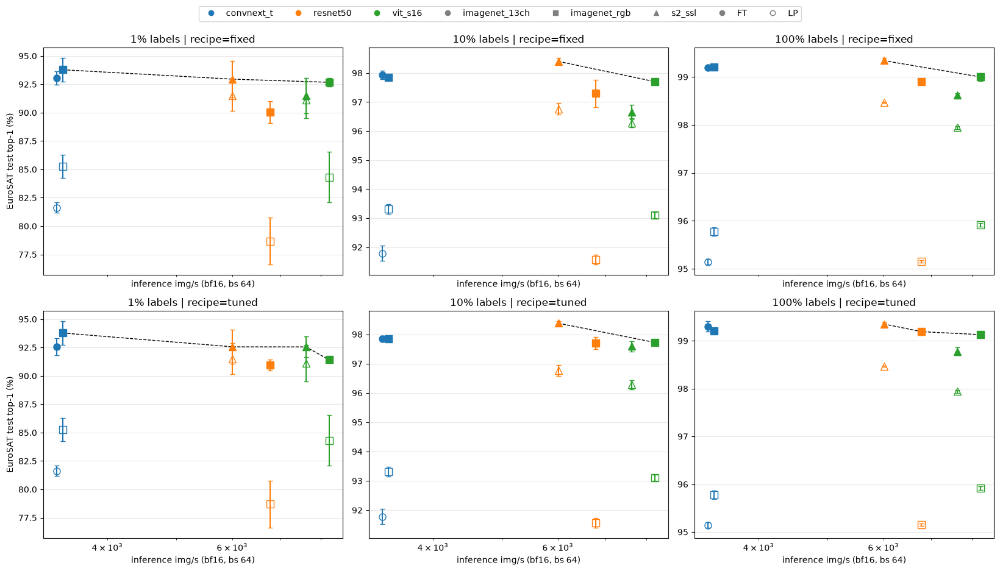

# eo-edge-zoo

[](https://github.com/ignaciomasari/eo-edge-zoo/actions/workflows/ci.yml)

Earth-observation models compared under **one evaluation protocol**: the same tasks, splits, label budgets and metrics for every model, so accuracy and speed numbers are directly comparable.

**Status: early.** Today the repo holds the evaluation harness and its first task (EuroSAT scene classification) with a study of six pretrained backbones. Planned: edge metrics (MACs, peak memory, CPU latency), ONNX export with INT8 accuracy, small student models with distillation, on-device numbers, and more tasks (cloud segmentation, small-object detection).

What the harness does:
- **One config per run:** a YAML file plus `key=value` overrides becomes a validated `RunConfig`; a hash of the recipe identifies the run.
- **Tasks:** a `Task` bundles dataset, bands, splits, head size and metrics; models adapt their input to the task's bands.
- **Grids:** a YAML file expands to the cartesian product of runs, with per-model rules. Each run is its own subprocess, finished runs are skipped, and failures are logged without stopping the grid.
- **Fine-tune or linear probe:** fine-tuning uses Lightning; linear probes train a linear head on cached frozen features.
- **Recipe tuning on validation data:** a sweep picks the best recipe per (backbone, init) on val and writes a new grid that applies it.
- **Analysis:** seed-averaged tables, seed-paired deltas, FT − LP gaps and accuracy-vs-throughput Pareto plots.

## Example: which backbone for few labels? (EuroSAT)

You have a Sentinel-2 classification task with few labels and want to know which pretrained backbone to start from, whether fine-tuning is worth it over a linear probe, and what accuracy costs in speed. One grid (`configs/grid.yaml`) runs 6 backbone/init pairs × {LP, FT} × {1 %, 10 %, 100 %} labels × 3 seeds. A sweep (`configs/sweep.yaml`) then tunes the fine-tuning recipe per pair and reruns it.

Backbones: ResNet-50, ViT-S/16 and ConvNeXt-T from timm. Inits: ImageNet weights on RGB, ImageNet weights with the stem tiled to all 13 bands, or Sentinel-2 self-supervised weights (SSL4EO-S12 MoCo, from torchgeo).


*Test top-1 vs inference throughput. Filled = fine-tune, hollow = linear probe; dashed = Pareto front of fine-tuned models. Mean ± std over 3 seeds.*

Test top-1 (%), mean ± std over 3 seeds; fine-tuning with each pair's tuned recipe:

| backbone | init | FT 1 % | FT 10 % | FT 100 % | LP 1 % | LP 10 % | LP 100 % | infer img/s |
|---|---|---|---|---|---|---|---|---|
| ConvNeXt-T | ImageNet RGB | **93.8 ± 1.0** | 97.9 ± 0.1 | 99.2 ± 0.1 | 85.3 ± 1.0 | 93.3 ± 0.2 | 95.8 ± 0.1 | 3.5k |
| ConvNeXt-T | ImageNet 13-band | 92.6 ± 0.8 | 97.8 ± 0.1 | 99.3 ± 0.1 | 81.6 ± 0.5 | 91.8 ± 0.3 | 95.1 ± 0.1 | 3.4k |
| ResNet-50 | ImageNet RGB | 91.0 ± 0.5 | 97.7 ± 0.2 | 99.2 ± 0.1 | 78.7 ± 2.1 | 91.6 ± 0.2 | 95.2 ± 0.0 | 6.8k |
| ResNet-50 | S2 SSL | 92.6 ± 1.5 | **98.4 ± 0.1** | **99.4 ± 0.0** | **91.5 ± 1.4** | **96.8 ± 0.2** | **98.5 ± 0.0** | 6.0k |
| ViT-S/16 | ImageNet RGB | 91.4 ± 0.2 | 97.7 ± 0.0 | 99.1 ± 0.0 | 84.3 ± 2.2 | 93.1 ± 0.1 | 95.9 ± 0.0 | **8.2k** |
| ViT-S/16 | S2 SSL | 92.6 ± 0.9 | 97.6 ± 0.2 | 98.8 ± 0.1 | 91.1 ± 1.6 | 96.3 ± 0.2 | 97.9 ± 0.0 | 7.6k |

What it showed:
- **For a frozen backbone, use Sentinel-2 SSL weights:** +12.8 pp (ResNet-50) and +6.8 pp (ViT-S) over ImageNet with a linear probe at 1 % labels.
- **When fine-tuning, the init matters much less:** within ~1.6 pp. ResNet-50 S2 SSL is best at 10–100 % labels, and ViT-S ImageNet is the fast option.
- **13 bands into ImageNet weights doesn't help;** the gain comes from in-domain pretraining.
- **A shared recipe can mislead:** ViT-S S2 SSL needed a 4× lower learning rate, which moved it from 1.1 pp behind to level at 10 % labels. A recipe tuned at 10 % labels doesn't always carry over to 1 %.

Caveats: 3 seeds, so differences under ~1.5 pp at 1 % labels are noise; pretraining sources differ across backbones; EuroSAT is near its ceiling with full labels. Throughput: synthetic batch of 64 at 224 px, bf16. The full analysis is in `notebooks/eurosat_bakeoff.ipynb`.

## Quickstart

```bash
pip install -e ".[geo,nb,test]"         # geo = torchgeo (data download + S2 weights), nb = notebook/plots
export EO_EDGE_ZOO_WORK_DIR=/data/work  # optional: root for data cache + outputs (default: ..)

python -m eo_edge_zoo.train --set mode=lp backbone=vit_s16 init=s2_ssl frac=0.01 seed=1   # one run
python -m eo_edge_zoo.grid configs/grid.yaml --dry-run                                     # list a grid's runs
```

## Documentation

- [Usage](docs/usage.md): configs and single runs, grids, recipe tuning, analysis
- [Extending](docs/extending.md): adding a task or backbone, code layout, tests
- [Licenses](docs/licenses.md): pretrained weights and datasets

## License

Code: [Apache-2.0](LICENSE). Pretrained weights and datasets keep their own licenses ([details](docs/licenses.md)); ImageNet-trained weights may carry non-commercial terms, and SSL4EO-S12 weights require attribution.
